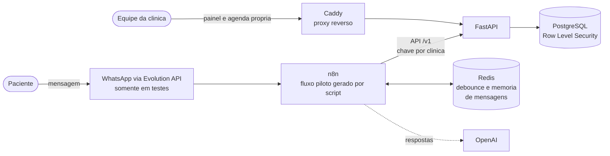

# MARFIM

**Assistente de IA no WhatsApp para clínicas odontológicas**
*(antes chamado Nexus)*

> **Aviso importante.** Este repositório é uma vitrine. O código do MARFIM é **privado**. Aqui está só a descrição do que foi construído, escrita a partir de fatos que consigo sustentar. O projeto está em **pré-lançamento interno**: não há clientes pagantes, não há piloto real e não há métricas de uso.

## O que é

O MARFIM é um SaaS de assistente virtual de IA que atende pacientes no WhatsApp para clínicas odontológicas, e entrega à clínica um painel com agenda própria, pacientes e conversas.

Time: Gabriel (único que programa), Joaquim (vendas) e JP (odontologia e Instagram).

## Problema

Clínicas pequenas respondem pacientes no WhatsApp à mão, fora do horário e entre atendimentos. O MARFIM foi pensado para responder, agendar e organizar essas conversas, deixando a equipe da clínica no controle pelo painel.

## Arquitetura

| Componente | Papel |
|---|---|
| Evolution API | Ponte com o WhatsApp. Usada **somente em testes** |
| n8n | Orquestra o fluxo. Fluxo piloto gerado por script, com deduplicação e teto de uso |
| API `/v1` (FastAPI) | Uma chave de API por clínica |
| PostgreSQL com RLS | Isolamento de dados por clínica no próprio banco |
| Redis | Debounce de mensagens e memória da conversa (armazena as mensagens do usuário) |
| Painel e agenda própria | Jinja2, papéis com escopo, login em 2 etapas para admin |
| Caddy | Proxy reverso |
| Docker Compose | Empacotamento dos serviços |

## Telas

| Tela | Para que serve |
|---|---|
| Hoje | Visão do dia da clínica |
| Agenda | Agenda própria do MARFIM |
| Pacientes | Cadastro e histórico |
| Conversas | Acompanhamento das conversas do assistente |
| Equipe | Gestão de pessoas e papéis |
| Clínica | Configurações da clínica |
| Painel do operador | Visão de operação |

## Segurança

Foram feitos 3 relatórios de segurança.

| Item | Situação |
|---|---|
| Falha de severidade **Alta**: profissional conseguia alcançar paciente de outra clínica | Encontrada e **corrigida** |
| M-1 (risco médio) | **Aberto e documentado** |
| M-2 (risco médio) | **Aberto e documentado** |

Também: login em 2 etapas para admin, papéis com escopo, chave por clínica na API, Redis com usuário e senha por serviço e contêineres com privilégios mínimos (preparado para o deploy).

## Privacidade

- Consentimento **versionado**
- Trilha de **auditoria**
- Ferramenta de **eliminação de dados por titular**
- Isolamento por clínica com Row Level Security

Estes são recursos técnicos implementados. **Não houve revisão jurídica**, então este projeto não afirma conformidade com nenhuma lei.

## Qualidade

| Verificação | Resultado |
|---|---|
| Testes (pytest) | cerca de **1.980** |
| CI no GitHub Actions | **6 de 6** checks no PR nº 1 |
| bandit, gitleaks, pip-audit | rodam no CI |
| Migrações numeradas | **21** |
| Cenários simulados offline do n8n | 41 |
| Versões | `v0.1.0` e `v0.1.1` |
| Landing page | 11 seções, Lighthouse mobile 100 em acessibilidade e boas práticas |

## O que está provado e o que ainda não foi

| O que está provado | O que ainda não foi provado |
|---|---|
| Suíte de cerca de 1.980 testes passando no CI (6 de 6) | Cliente pagante |
| Isolamento por clínica (RLS) e 21 migrações | Piloto real |
| Falha Alta encontrada e corrigida | Uso real com n8n, Evolution API, WhatsApp e OpenAI |
| Fluxo n8n validado por 41 cenários simulados offline | VPS e domínio contratados |
| Consentimento, auditoria e eliminação por titular implementados | Ensaio de infraestrutura após o endurecimento final |
| Varreduras bandit, gitleaks e pip-audit no CI | Backup na VPS |
| | Revisão jurídica, termo de piloto e registro no INPI |
| | Correção de M-1 e M-2 |

## Roteiro

1. Fechar M-1 e M-2.
2. Contratar VPS e domínio e ensaiar a infraestrutura após o endurecimento final (portões A, B e C, script de teste pós-deploy, unidades systemd, backup cifrado).
3. Revisão jurídica e termo de piloto.
4. Piloto com uma clínica.

## Como foi feito

O desenvolvimento foi feito com agentes de IA (**Claude Code**), com revisão e decisões minhas, testes automatizados e relatórios de segurança. Uso IA generativa como ferramenta, com disciplina de engenharia.

## Autor

Gabriel Nagatani Campos, estudante de Engenharia de Software (UMC). [Portfólio](https://gabrielnagatanicampos.github.io)
