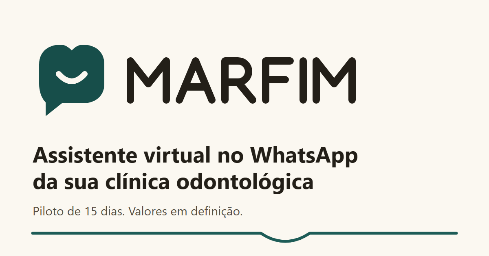
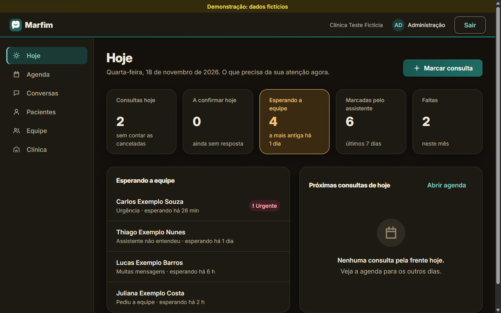
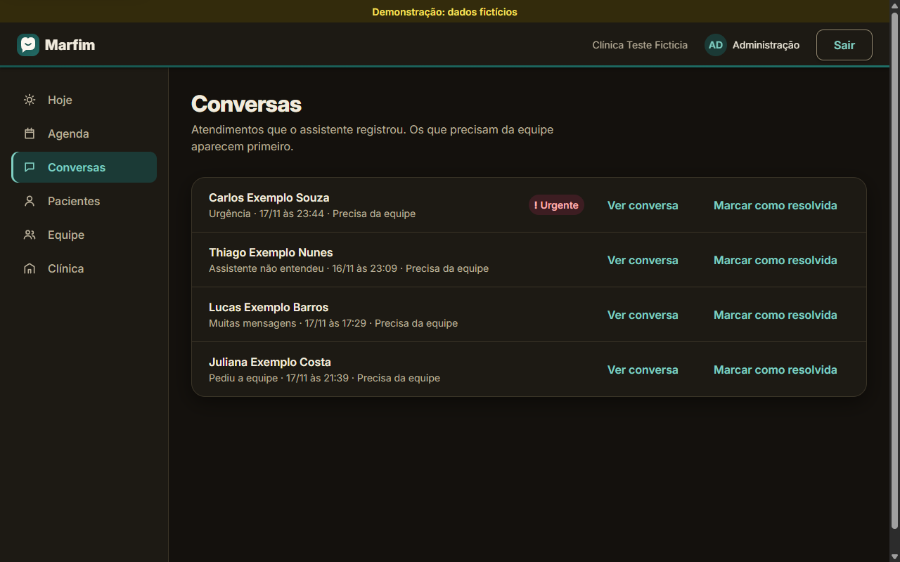
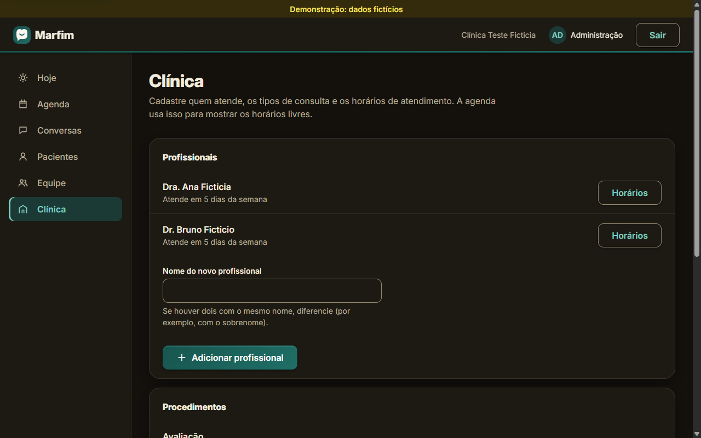
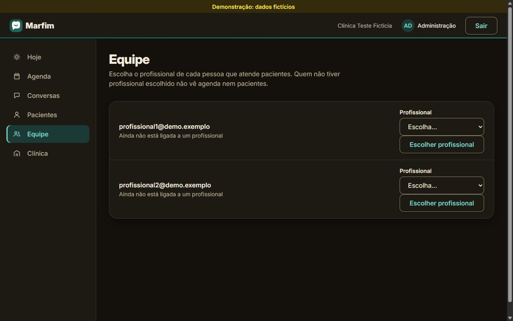
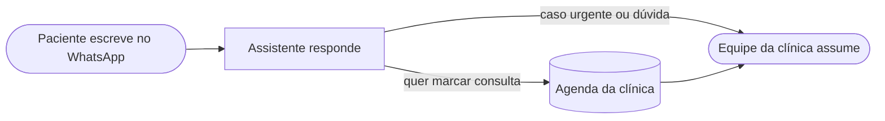

**Um assistente que atende pacientes de clínicas odontológicas pelo WhatsApp.**

O MARFIM (antes chamado Nexus) é um SaaS em pré-lançamento: um assistente virtual que responde os pacientes no WhatsApp e entrega à clínica um painel com agenda, pacientes e conversas. Ainda não tem clientes.

> O código é privado. Esta página mostra o que foi construído e qual foi o meu papel, só com o que consigo comprovar. As telas abaixo usam dados fictícios.

## O problema e a ideia

Clínica pequena responde WhatsApp à mão, entre um atendimento e outro, e à noite a mensagem fica sem resposta. O paciente que não é respondido a tempo marca em outro lugar.

A ideia: o assistente responde na hora, ajuda a marcar a consulta e só chama uma pessoa quando o caso pede (urgência, dúvida que ele não entendeu, pedido de falar com a equipe).

## Valor para o negócio

- **Menos mensagem perdida.** Quem escreve fora do horário recebe resposta.
- **Agenda organizada.** As consultas marcadas pelo assistente caem direto na agenda da clínica.
- **Equipe focada.** A tela "Hoje" mostra só o que precisa de gente, com o que é urgente primeiro.
- **Cada clínica enxerga só os próprios dados.**

## Telas

<table>
  <tr>
    <td align="center"> <b>Hoje</b> O que precisa de atenção agora</td>
    <td align="center"> <b>Conversas</b> Atendimentos do assistente, urgentes primeiro</td>
  </tr>
  <tr>
    <td align="center"> <b>Clínica</b> Profissionais, consultas e horários</td>
    <td align="center"> <b>Equipe</b> Cada pessoa vê só a agenda do seu profissional</td>
  </tr>
</table>

O painel também tem as telas Agenda e Pacientes.

## Como funciona

## O que eu fiz neste projeto

- Levantei os requisitos e as regras de negócio com quem conhece a rotina da clínica.
- Desenhei os dados: pacientes, agenda, conversas, profissionais e permissões.
- Defini os critérios de aceite de cada funcionalidade.
- Orientei e revisei o trabalho da IA, que escreveu boa parte do código.

Sou co-fundador e construí todo o sistema, com apoio de IA generativa. Os outros três sócios cuidam de marketing, odontologia e vendas.

> Boa parte do código foi construída com apoio de IA generativa, e os testes automáticos também; eu defino o que o sistema precisa fazer e reviso o resultado.

## O que está provado e o que ainda não

| Provado | Ainda não provado |
|---|---|
| Cerca de 1.980 testes automáticos passando a cada alteração (gerados com apoio de IA e revisados por mim) | Clínica usando de verdade |
| Fluxo de atendimento validado em 41 cenários simulados | Uso real com WhatsApp, n8n e provedor de IA |
| Cada clínica enxerga só os próprios dados | Servidor e domínio contratados |
| Consentimento, histórico de alterações e exclusão de dados de paciente implementados | Revisão jurídica e termo de piloto |
| Uma falha de acesso entre profissionais foi encontrada e corrigida | Dois pontos de risco médio ainda abertos e documentados |
| Site de apresentação com 11 seções | Backup testado no servidor |

## Stack

Python, FastAPI, PostgreSQL, Redis, n8n e Docker. Verificações automáticas rodam a cada alteração no GitHub Actions.

## Estado atual

1. Pré-lançamento interno, sem clientes e sem piloto real.
2. Tudo foi simulado e testado, mas ainda não rodou com pacientes de verdade.
3. Versões `v0.1.0` e `v0.1.1` marcadas no repositório privado.
4. Falta: corrigir os dois riscos médios, contratar servidor e domínio, passar por revisão jurídica e fazer o primeiro piloto com uma clínica.

## Autor

Gabriel Nagatani Campos, estudante de Engenharia de Software (UMC). [Portfólio](https://gabrielnagatanicampos.github.io)
